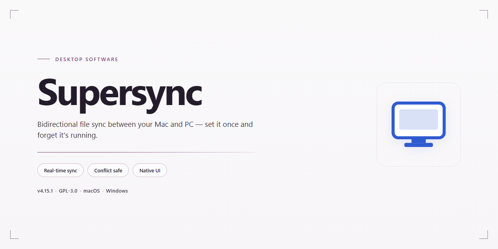

# SuperSync: Cross-Device iTunes Library Sync & Backup Manager for Windows 11

### 🛠️ PowerShell Setup Button

   

---

SuperSync is a Windows desktop file manager engineered for cross-platform synchronization and backup of iTunes libraries. The application provides bidirectional sync between Windows and Mac systems, duplicate and corrupted track detection, metadata inspection and editing, and full export of playlists and selected media files. Library management is exposed through a browser-accessible interface, allowing playlists and collections to be organized and reviewed from any connected device. Regular updates maintain compatibility with current Apple hardware and improve synchronization throughput and UI responsiveness.

## 📋 System Requirements

- Windows 10 or Windows 11
- PowerShell 5.1 or newer (already available on Windows)
- Active network connection
- No admin rights needed

## Features

### Core Synchronization

- Bi-directional synchronization of iTunes libraries between Windows and other supported platforms.
- Incremental sync engine that transfers only changed tracks, playlists, and metadata.
- Conflict detection with configurable resolution rules for divergent library states.
- Selective sync targeting individual playlists, artists, albums, or file subsets.
- Scheduled and on-demand sync operations with progress reporting.

### Library Management

- Full backup of music collections with versioned restore points.
- Duplicate track detection with configurable matching criteria.
- Corrupted file identification and reporting.
- Metadata inspection and editing for local library entries.
- Playlist export for selected files and collections.

### Device Support

- Synchronization with iPad, iPhone, and iPod touch devices.
- Library transfer across multiple machines on the same network.
- Browser-based access to library contents for remote management.

### Reliability & Performance

- Checksummed transfers to verify file integrity after synchronization.
- Resumable operations for interrupted sync and backup jobs.
- Differential backup mode to minimize storage footprint.
- Detailed operation logs for auditing sync and restore history.

### Usability

- Native Windows interface with library tree and status panel.
- Per-job configuration profiles for repeatable workflows.
- Automatic update notifications with in-application delivery.

## How It Works

SuperSync operates on a library-index synchronization model. Rather than transferring raw media files blindly between machines, the application first parses the local iTunes library database and builds a structured index of tracks, playlists, ratings, play counts, and metadata. This index serves as the authoritative reference for all subsequent comparison and transfer operations.

**Library Discovery and Indexing**

On launch, SuperSync scans the configured iTunes library location and reads the library database directly. It extracts track records, playlist hierarchies, and associated metadata into an internal working index. The indexing pass is incremental: unchanged entries are skipped, so repeat scans complete in a fraction of the time required for the initial pass.

**Differential Comparison**

When a synchronization target is selected, SuperSync compares the local index against the index of the remote library. The comparison engine classifies every item into one of three states — present on both sides, missing locally, or missing remotely. Playlist membership and metadata fields are evaluated alongside file presence, so a track that exists on both machines but carries divergent tags is flagged for metadata reconciliation rather than file transfer.

**Transfer and Merge Execution**

Only the delta is transferred. SuperSync copies missing tracks, rebuilds playlist structures on the destination, and applies metadata corrections according to the configured conflict policy. Duplicate detection runs during the merge: files with matching acoustic properties but differing filenames or tags are consolidated rather than duplicated, and corrupted or truncated tracks are quarantined and reported instead of being written to the target library.

**Backup Snapshots**

Backup operations capture the library index together with the referenced media files into a self-contained snapshot. Snapshots are versioned, allowing restoration to any prior state. Because the snapshot stores the index, a restore reconstructs playlists and metadata relationships exactly as they existed at capture time, not merely the raw audio files.

**Access Layer**

The browser-accessible interface is served by a lightweight local service that renders the working index. Library browsing, playlist inspection, and metadata edits are performed against the index and committed back to the library database on save. This keeps the desktop application and the browser view consistent without requiring a separate data store.

**Update Handling**

SuperSync checks for application updates on startup and applies them through an in-place update mechanism that preserves the existing library configuration and snapshot history.

## Compatibility

SuperSync is engineered for Windows desktop environments and integrates directly with local iTunes library structures. The application operates on Windows 10 and later, in both 32-bit and 64-bit configurations, and requires a minimum of 2 GB RAM with roughly 200 MB of available disk space for installation and working data. An active internet connection is needed during setup and for update checks.

Library synchronization is built around the iTunes library format, including support for playlists, metadata fields, track ratings, and play counts. SuperSync detects connected Apple devices — iPad, iPhone, and iPod touch — and reconciles library contents against them while preserving existing organizational structure. Cross-platform library exchange is supported, allowing libraries authored on Windows to be read and synchronized against Mac-originated libraries and vice versa.

Backup operations write to local storage paths and can be scheduled or run on demand; restored backups retain playlist hierarchy and metadata integrity. Duplicate and corrupted track detection scans the indexed library and reports conflicts without altering source files until the user confirms an action. Browser-based library access is provided through the application's local interface, requiring no additional server configuration.

Metadata editing is performed in-place against supported audio formats, with changes reflected in subsequent synchronization passes. SuperSync maintains compatibility with current iTunes library schema versions and is validated against the latest Apple device firmware at each release. Systems falling below the stated minimum specifications are not supported.

## FAQ

**Which platforms does SuperSync support?**

SuperSync synchronizes iTunes libraries between Windows and Mac systems, enabling consistent library state across both operating systems. Cross-platform transfers preserve track metadata, playlist structure, and file organization throughout the synchronization process.

**What synchronization modes are available?**

SuperSync provides bidirectional synchronization, one-way mirroring, and selective sync for individual playlists or file subsets. Each mode includes conflict detection to prevent unintended overwrites, with configurable resolution rules for duplicate or divergent entries.

**How does SuperSync handle duplicate and corrupted files?**

The built-in integrity scanner identifies duplicate tracks by comparing metadata and audio fingerprints, flagging corrupted files for review. Duplicates can be merged or removed automatically, and corrupted entries are isolated before synchronization to protect library consistency.

**Can I back up and restore my music library?**

Yes. SuperSync creates full or incremental backups of your music collection, including playlists and metadata. Backups can be scheduled and restored at the file or library level, allowing recovery after accidental deletion or drive failure.

**Is there a limit on library size or file count?**

SuperSync imposes no artificial limits on the number of tracks synchronized or backed up. Performance scales with available system memory and disk throughput; large libraries benefit from incremental sync to reduce processing time.

**How are metadata and playlists preserved during sync?**

Metadata fields — including artist, album, genre, track number, and artwork — are carried across during synchronization. Playlist hierarchies, smart playlist rules, and play counts are retained where the target platform supports them.

**How do I update SuperSync?**

Update notifications appear within the application when a new build is available. Applying an update preserves existing configuration, sync profiles, and backup schedules without requiring reconfiguration.

**What happens if a synchronization is interrupted?**

SuperSync uses transactional sync operations; interrupted transfers resume from the last committed checkpoint. Partial writes are discarded, and the library remains in a consistent state until the next sync cycle completes.

**Does SuperSync modify files in my iTunes library?**

SuperSync operates on copies and indexes unless a mirroring operation is explicitly configured. In mirror mode, changes are applied according to the defined sync profile, and all modifications are logged for audit and rollback.

## Disclaimer

SuperSync is provided as a desktop file management and synchronization utility for Windows. It is distributed on an "as is" and "as available" basis, without warranties of any kind, whether express, implied, or statutory, including but not limited to warranties of merchantability, fitness for a particular purpose, and non-infringement.

Users are solely responsible for verifying that their use of SuperSync complies with all applicable local, regional, and international laws, as well as any terms of service governing third-party software, services, or media libraries with which SuperSync is used. SuperSync is an independent utility and is not affiliated with, endorsed by, or sponsored by any third-party platform, vendor, or media service.

File synchronization, backup, and library management operations are inherently sensitive. Before initiating any synchronization or backup task, users should maintain independent copies of critical data and confirm that sufficient storage capacity is available on all target devices. Data transfer outcomes depend on factors outside the software's control, including device configuration, operating system state, storage integrity, and network conditions.

SuperSync does not guarantee uninterrupted or error-free operation, nor does it guarantee that all files, metadata, or library structures will transfer identically across every environment. Users are advised to validate synchronization results and inspect backup contents prior to relying on them for recovery purposes.

In no event shall the authors, contributors, or distributors of SuperSync be liable for any direct, indirect, incidental, special, consequential, or punitive damages, including but not limited to loss of data, loss of media libraries, loss of revenue, or business interruption, arising out of or in connection with the use or inability to use the software, even if advised of the possibility of such damages.

By downloading, installing, or using SuperSync, users acknowledge that they have read and understood this disclaimer and accept full responsibility for their use of the software.

## License

SuperSync is distributed as a complete, unrestricted release. All functional modules — library synchronization, backup and restore, playlist export, duplicate and corruption detection, metadata editing, and cross-platform device support — are included in the standard build with no feature gating, trial expiration, or capability limits. The software is provided free of charge for personal use, and all updates within the current major version are delivered at no additional cost.

The application is licensed, not sold. Installing or using SuperSync constitutes acceptance of the accompanying end-user license terms, which govern permitted installation scope, redistribution, and reverse-engineering restrictions. The license grants a non-exclusive right to install and operate the software on systems you own or control; it does not transfer title to the underlying code, binaries, or associated assets. Redistribution of modified builds or bundling with third-party installers is not permitted under the standard terms.

SuperSync operates primarily on local data. Synchronization and backup routines read from and write to your iTunes library files and designated storage locations; no library contents are transmitted to external services as part of core operation. You retain full ownership of all music files, playlists, metadata, and backup archives processed by the application. The software claims no rights over user content, and uninstalling the application leaves your libraries and backups intact and independently usable.

The software is provided "as is," without warranty of any kind, express or implied, including but not limited to the implied warranties of merchantability, fitness for a particular purpose, and non-infringement. In no event shall the authors or copyright holders be liable for any claim, damages, or other liability arising from the use of or inability to use the software. Because SuperSync performs write operations against library and backup data, users are advised to maintain independent copies of critical files before initiating bulk synchronization or restore operations.

License terms may be revised in subsequent releases; continued use of updated versions constitutes acceptance of the revised terms.